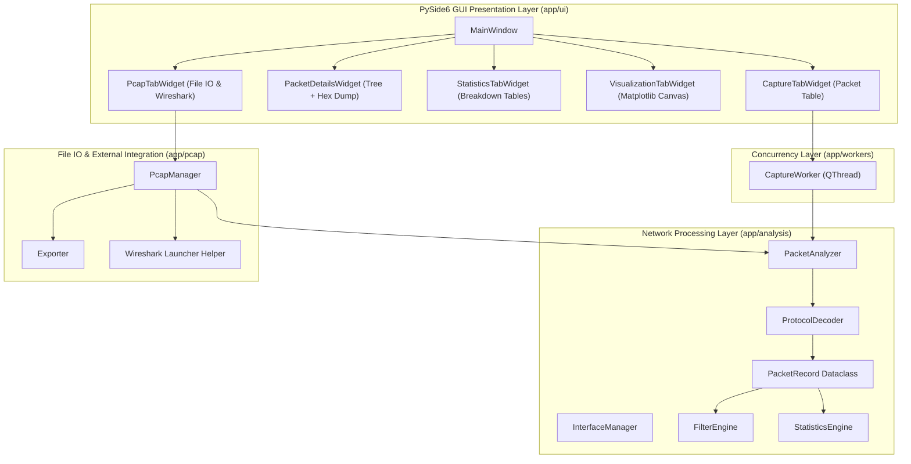

# NetScope — Architecture & Engineering Specification

## 1. Architectural Principles & Overview

NetScope is engineered as a modular, decoupled desktop application for network packet sniffing and protocol analysis built on top of **Python 3.10+**, **Scapy**, **PySide6 (Qt)**, and **Matplotlib**.

The system separates concerns into three distinct layers:
1. **Network Engine Layer** (`app/analysis`, `app/capture`, `app/pcap`): Decoupled, headless network frame dissection, BPF filtering, and statistics computation.
2. **Concurrency Layer** (`app/workers`): Asynchronous non-blocking Qt QThread streams isolating live sniffing and synthetic generation from the GUI thread.
3. **Presentation Layer** (`app/ui`): PySide6 dark-themed GUI rendering dynamic metric cards, packet tables, tree structures, Wireshark hex views, and Matplotlib visual analytics.

---

## 2. Core Modules & Component Responsibilities

### `app.analysis.packet_models`
- Defines normalized, immutable-style dataclasses: `PacketRecord`, `LayerDetail`, `FieldDetail`, `ProtocolType`.
- Prevents coupling between Scapy-internal packet objects and GUI widgets.

### `app.analysis.protocol_decoder`
- Implements layer-by-layer dissection (Ethernet II, ARP, IPv4, IPv6, ICMP, TCP, UDP, DNS, HTTP, TLS metadata, DHCP).
- Operates defensibly with fallback checks for uninstantiated or missing frame attributes.

### `app.analysis.packet_analyzer`
- Converts raw Scapy packet frames into `PacketRecord` objects.
- Isolates malformed frames without crashing application state.

### `app.analysis.filters`
- Performs fast in-memory display filtering across protocol types, IP addresses, ports, and payload search text.
- Validates BPF filter syntax prior to capture execution.

### `app.analysis.statistics`
- Aggregates metrics including total packet volume, total byte volume, min/max/average packet sizes, top source/destination talkers, top ports, and timeline series.

### `app.workers.capture_worker`
- Subclasses `QThread` to execute non-blocking packet capture in a background thread.
- Provides dual operational modes:
  - **Live Mode**: Uses Scapy `sniff()` on physical network interfaces.
  - **Demo Mode**: Streams realistic multi-protocol synthetic traffic for offline reviews.

---

## 3. Wireshark vs. Scapy Engineering Roles

| Aspect | Wireshark / TShark | Scapy (NetScope Engine) |
| :--- | :--- | :--- |
| **Primary Role** | External professional packet visualizer & validation engine | Programmable Python network layer & packet parser |
| **Usage in NetScope**| Optional secondary launcher tool to inspect saved PCAP files | Core engine for capturing, parsing, filtering, and metric generation |
| **Dependency Context**| Optional external binary (app works cleanly without it) | Core hard dependency installed via pip |

---

## 4. Concurrency & Thread Safety

To guarantee a smooth, responsive UI during high-rate packet capture:
- The main Qt event loop is dedicated solely to GUI rendering and user interactions.
- Network sniffing occurs inside `CaptureWorker` (`QThread`).
- Thread communication relies exclusively on Qt signals (`packet_captured`, `capture_finished`, `capture_error`), eliminating shared lock contention.
